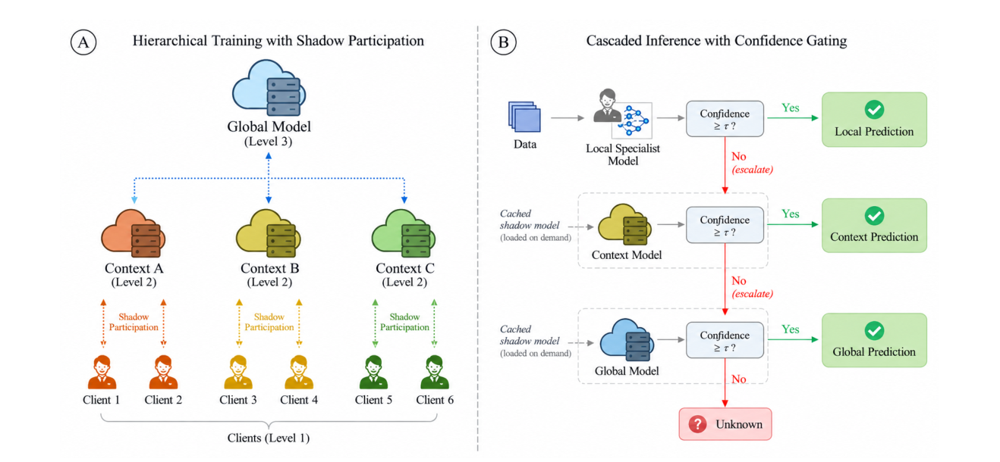

# TEMPO-FL

**Temporary Model Escalation and Selective Promotion for Adaptive Hierarchical Federated Learning**

Federated learning shares model updates while keeping training data at the clients. With heterogeneous client data, however, one shared model can lose the specialization needed locally. TEMPO-FL separates contribution to federated training, temporary inference support, and persistent knowledge transfer.

Each client retains a **Level 1 (L1) specialist** as its default model. **Level 2 (L2) context models** combine knowledge within groups, and a **Level 3 (L3) global model** combines broader knowledge. Clients cache higher-level models as shadow models. Through **shadow participation**, clients train copies of the context model on local data and contribute updates to the hierarchy without replacing their specialist.

For each input, the independently calibrated L1 model predicts first. If confidence is insufficient, the input escalates to cached L2, then L3 if necessary. If every level rejects it, the outcome is **Unknown**, an abstention rather than an extra trained class. After temporary escalation, L1 remains the default inference model.

Transient reliance on higher levels does not automatically change the specialist. Persistent reliance, together with evidence that a higher-level teacher can resolve escalated inputs, can trigger **selective promotion**. A candidate starts from the current specialist and receives knowledge through local-data replay and teacher knowledge distillation. Acceptance requires performance and specialization safeguards. An accepted candidate is recalibrated and its monitoring baseline updated; a rejected candidate does not replace the specialist.



*Figure 1, extracted directly from page 5 of the [included paper](TEMPO_FL.pdf). This schematic illustrates six clients; the reference experiments use eight clients and four contexts.*

This package contains TEMPO-FL and its three accompanying comparison protocols, including training, evaluation, reporting and export procedures. The introduction follows the paper. Scientific execution follows the designated notebooks; qualifications appear below. No new experimental findings or general superiority are claimed.

## Comparison methods

- **Flat FedAvg / Simple FedAvg:** clients update a shared model on local data; the server forms a sample-weighted global aggregate.
- **Hierarchical FedAvg / Simple HFL:** client updates are aggregated at the context level, followed by coordination at the global level.
- **Ditto:** a shared global model is learned alongside persistent personalized client models, regularized toward the global model.

These are the accompanying notebook implementations. Ditto retains its own objective and update ordering. Flat FedAvg has no context aggregation. The baselines do not acquire TEMPO-FL's cascade or promotion mechanism.

## Installation

Tested on **Windows, Python 3.12.4, TensorFlow 2.16.1 and Keras 3.3.3, using CPU execution**. [requirement.txt](requirement.txt) is the sole dependency file, pinning the tested runtime packages, including NumPy 1.26.4, pandas 2.2.3 and Rich 13.9.4. Package installation reads dependencies from it. Other platforms have not been certified; native Windows GPU support is not claimed.

Replace the placeholders with your repository URL and directory; no published URL is assumed:

```powershell
git clone <REPOSITORY_URL>
cd <REPOSITORY_DIRECTORY>
py -3.12 -m venv .venv
.\.venv\Scripts\python.exe -m pip install -r requirement.txt
.\.venv\Scripts\python.exe -m pip install -e . --no-deps
```

The first experiment downloads the original TrashNet archive and the ImageNet MobileNetV2 weights selected by the configuration. Uncached downloads require network access. Neither data nor weights are included in the repository. Defaults cache them in `datasets/` and `.cache/keras/`. Presets retain the original dataset URL/acquisition behavior; existing custom-dataset settings also support a local dataset directory.

The distribution remains `tempo-fl`; its Python package is **`implementation`**:

```python
from implementation.config.schema import RunConfig
config = RunConfig.defaults("tempo")
config.validate()
```

## Interactive terminal

Double-click **`Launch TEMPO-FL.cmd`** on Windows, or run:

```powershell
.\.venv\Scripts\python.exe -m implementation
```

After activating the environment, `tempo-fl` opens the same application. The terminal uses plain text and typed keys, without colors, selection arrows, animated redraws or escape sequences.

1. **Overview:** review method, preset, paths and departures from Reference.
2. **Select method:** choose `tempo`, `ditto`, `hfl` or `flat`. Each method retains its configuration draft.
3. **Categorized configuration:** edit applicable data, model, training, hierarchy, routing, promotion and output settings. Use `?NUMBER` before editing, or `?` within an edit, for help. Save/load JSON configurations or restore Reference defaults here.
4. **Data and output locations:** select the dataset cache and experiment destination.
5. **Start experiment:** review settings and launch a separate worker process.
6. **Run monitoring:** inspect stages, rounds, epochs, actual elapsed time, metrics and bounded recent logs. Complete logs remain on disk.
7. **Request safe stop:** request cooperative interruption. Completed round checkpoints remain valid; interruption during initialization can require restarting initialization.
8. **Resume committed run:** continue from a compatible complete checkpoint. Weights-only loading is not full resume.
9. **Inspect measured results:** read saved metric tables.
10. **How the methods work:** view terminal explanations and diagrams.
11. **Open paper:** open the sole included PDF in the system's default viewer.
12. **Project information:** view project identity and reference qualifications. Use `q` to exit.

Expensive initialization and experiments execute outside the menu process. Redirected output uses sequential logs; menus require a terminal. Resources resolve independently of the launch directory. `TEMPO_FL_HOME` can explicitly set a writable experiment home for an installed copy.

## Command-line execution

Menus and commands use the same scientific core. These examples assume an active environment (`.\.venv\Scripts\Activate.ps1` on PowerShell). `python -m implementation` can replace `tempo-fl` throughout.

```powershell
tempo-fl --help
tempo-fl methods
tempo-fl doctor
tempo-fl config reference --method tempo --output runs/my-tempo.json
tempo-fl config show --config runs/my-tempo.json
tempo-fl config help persistence_rounds --method tempo
tempo-fl config validate --config runs/my-tempo.json
tempo-fl run --config runs/my-tempo.json
```

`run` prints its unique run directory. Substitute it below. `--detach` returns control while the worker continues. `Ctrl+C` while monitoring requests a cooperative stop.

```powershell
tempo-fl run --config runs/my-tempo.json --detach
tempo-fl monitor --run-dir "<RUN_DIRECTORY>" --follow
tempo-fl stop --run-dir "<RUN_DIRECTORY>"
tempo-fl resume --run-dir "<RUN_DIRECTORY>"
tempo-fl results --run-dir "<RUN_DIRECTORY>"
tempo-fl explain --method tempo
tempo-fl paper
```

Edit a configuration copy or create an explicitly reduced verification preset:

```powershell
tempo-fl config set --config runs/my-tempo.json --set num_rounds=10 --output runs/my-tempo-10.json
tempo-fl config verification --method flat --output runs/check-flat.json
tempo-fl run --config runs/check-flat.json
```

Reduced presets execute the real methods with disclosed smaller model/training budgets. They are **not paper reproduction**. The phase calendar remains unchanged: two rounds do not exercise later distribution-shift phases.

## Reference configurations and traceability

There is **one configuration directory**, [implementation/config](implementation/config), with separate `tempo_fl/`, `ditto/`, `hfl/` and `flat/` folders. Each contains `reference.json` and `verification.json`. Shared schema/validation, parameter help and source identities remain at the directory root. See the [configuration guide](implementation/config/README.md) for preset selection, editing and examples. Scientific defaults come from cell 3 of the corresponding notebook. Portability replaces notebook-specific filesystem paths with local paths.

| Key | Method package | Authoritative notebook in `references/Codes/` |
| --- | --- | --- |
| `tempo` | `implementation/methods/tempo_fl/` | `TEMPO_FL_V12_2_MemorySafe_Detailed_OwnedClass_HFL_TrashNet.ipynb` |
| `ditto` | `implementation/methods/ditto/` | `TEMPO_FL_V12_2_Ditto_Personalized_TrashNet_FIXED.ipynb` |
| `hfl` | `implementation/methods/hfl/` | `TEMPO_FL_V12_2_FedAvg_Baseline_TrashNet_FIXED.ipynb` |
| `flat` | `implementation/methods/flat/` | `TEMPO_FL_V12_2_Flat_FedAvg_Baseline_TrashNet.ipynb` |

[reference_sources.json](implementation/config/reference_sources.json) records notebook SHA-256 hashes, important zero-based cell indices and destination modules. The local `tests/reference_index.json` maps functions to original notebooks/cells and destination files. The `tests/` and `references/` directories are local verification materials excluded from Git; they are not needed to install or run the application. Frozen notebooks are verification inputs only: production never executes notebooks or requires the original parent directory.

Reference settings retain seed 42, 100 rounds, original partitions, ownership and training budgets. The model uses ImageNet MobileNetV2, 128-pixel input, width multiplier 0.75, source layer-freezing rules and logits output. Each method's own defaults remain authoritative where similarly named parameters differ.

## Outputs and reproducibility

Each experiment creates a unique directory under `runs/`, recording resolved configuration/departures, dataset/class/partition manifests, reference hashes, environment/hardware, events, logs, metrics, models, figures and reference exports. Large outputs, caches, environments and checkpoints are ignored by Git. Locations can be changed explicitly.

Round checkpoints retain reference runtime state, random-generator state and the model/optimizer state needed for continuation. TEMPO-FL state includes calibration, reliance histories, teacher buffers, cooldowns and promotion counters. Atomic commit markers and compatibility checks reject incomplete or incompatible snapshots. Resume requires matching method, configuration, data and implementation identities. Old checkpoints are not supported after this reorganization.

Results distinguish general-test/owned-class, initial/final, specialist-only/cascade, accepted-prediction accuracy, coverage/Unknown rate and routing/promotion events where applicable. Fixed-label versus present-class macro-F1 follows original call sites. Operational draws can repeat images; they are not unique test samples or independent repeated experiments. Audit/final-test labels do not drive operational routing or promotion.

Seeds and preprocessing follow the references. Hardware, TensorFlow/Keras versions and kernels can still affect numerical results; cross-platform bitwise equality is not promised. Calibration, validation/model-selection, operational and final-test roles retain reference separation.

### Reference qualifications

- The paper's primary-class prose differs from its two-owned-class assignment table. Executable assignments are preserved.
- The code's "Trust-Region" behavior uses existing validation/blending/acceptance gates. No mathematical radius constraint has been added.
- Existing audit/reporting expressions and metric conventions remain unchanged, including integer-label bitwise operations in `beneficial_override_mask` and `harmful_override_mask` in `implementation/methods/tempo_fl/inference/routing.py`. The resulting beneficial/harmful override counts are unreliable; the routing decisions are unaffected. This refactor does not repair scientific defects.
- Notebook globals became isolated experiment state. Local paths, worker events, cooperative interruption, atomic checkpoints and a Keras 3 converter compatibility bridge provide infrastructure while retaining scientific formulas and stage ordering.

## Verification and project layout

The reference-parity tests and extraction audit require the local `tests/` and `references/` directories, which are excluded from Git. A fresh clone does not contain these materials. Where they are available, install development dependencies with `python -m pip install -e ".[dev]"`, then run:

```powershell
python -m pytest -q
python tools/audit_extraction.py
python tools/verification_runs.py --method all
```

Tests compare controlled fixtures against original notebook definitions: defaults, partitions, ownership, initialization, losses/updates, aggregation, calibration, routing, promotion gates, metrics and checkpoint restoration. The syntax audit checks 268 original-function comparisons. These checks do not establish complete numerical equivalence. Build/package/export checks are explained in [tools/README.md](tools/README.md).

Verification on 11 November 2026: **66 tests passed**, **268 original-function comparisons had zero divergences**, and **all four methods completed two-round real-data verification runs with stop/resume and archive-integrity checks**. Flat FedAvg full-INT8 TFLite export and interpreter invocation also passed. All 160 scientific function bodies remained identical across the folder reorganization.

Full 100-round reference experiments have **not** been rerun for this reorganization. Later-phase behavior and reproduction of the paper's numerical results remain unverified. No benchmark numbers are presented as newly produced results.

```text
implementation/
  methods/
    tempo_fl/       # TEMPO-FL training, inference, runtime, evaluation, reports
    ditto/          # Ditto training, runtime, evaluation, reports
    flat/           # Flat FedAvg training, runtime, evaluation, reports
    hfl/            # Simple HFL training, runtime, reports
  shared/           # Equivalent shared scientific/data/reporting operations
  config/           # Per-method preset folders, README, validation and help
  execution/        # Shared experiment lifecycle and worker-process control
  persistence/      # Shared atomic checkpoints and archive infrastructure
  cli/              # Plain English terminal menus and commands
references/Codes/   # Local-only, Git-ignored verification inputs
tests/              # Local-only, Git-ignored tests and function/cell index
tools/              # Maintainer tools and their README
assets/             # Original paper figure
TEMPO_FL.pdf        # Sole source-tree paper copy
requirement.txt     # Canonical pinned runtime dependencies
pyproject.toml      # Package metadata and development extras
```

Author attribution remains in the paper and source references. No license, publication status, repository URL or DOI is assigned here.
